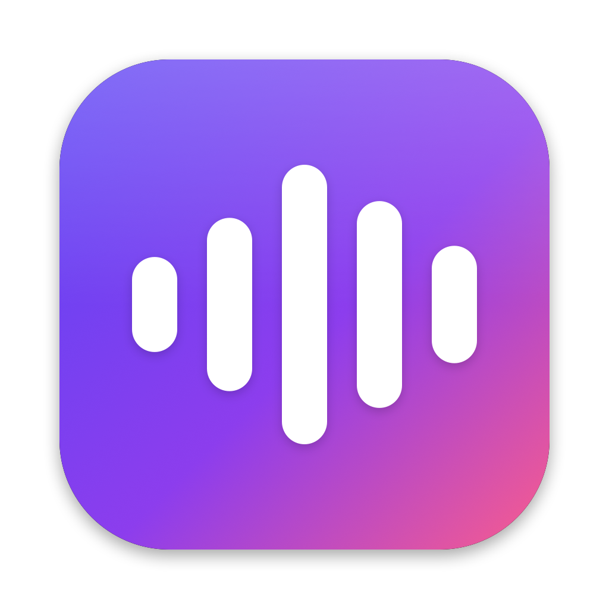

# OpenFlow

Local hold-to-talk dictation for macOS. Hold **right ⌥**, speak German or English, release, and the
text is pasted into whatever field has focus: Claude, Slack, a browser, anything.

- **Fully local:** NVIDIA [Nemotron 3.5 ASR Streaming 0.6B](https://huggingface.co/nvidia/nemotron-3.5-asr-streaming-0.6b)
  runs on the Apple GPU (MPS), with the language auto-detected per utterance (40 locales).
- **Streaming:** a Liquid Glass HUD shows the transcript live while you speak. New words blur in, and a
  badge shows the detected language.
- **Clean output:** fillers (äh, ähm, öh, hm; um, uh, erm in English) are removed, and your clipboard
  is restored after pasting.
- **Transcription mode:** double-tap right ⌥ in a meeting. A side panel transcribes **You** (your mic)
  and **Them** (whatever your Mac plays) and saves Markdown as you go; a small local LLM cleans up
  each segment.

## Requirements
- Apple Silicon Mac, macOS 15+ (macOS 26 for the Liquid Glass look; older versions fall back to a blur material)
- Swift 6 toolchain (Xcode or the Command Line Tools: `xcode-select --install`)
- [uv](https://docs.astral.sh/uv/) (`brew install uv`)
- ~3 GB disk for the model and Python environment

## Setup
```bash
cd asr && uv sync                     # Python 3.12 env: torch, transformers, librosa
uv run bench.py ../samples/*.wav      # downloads the model (~2.4 GB) once and benchmarks it
uv run polish.py                      # downloads the transcript-polish LLM (~3 GB) once
cd ..
scripts/make-cert.sh                  # once: stable code signature (see below)
scripts/build-app.sh && open build/OpenFlow.app
```
On first launch, grant permissions in **System Settings → Privacy & Security**:
- **Microphone** to capture audio
- **Accessibility** to paste with ⌘V
- **Input Monitoring** for the global hotkey
- **Screen & System Audio Recording → System Audio Recording Only** for "Them" in transcription
  mode (asked on the first transcription). Until it's granted, macOS delivers silence: the panel's
  "Them" meter stays flat even while others talk

Quit and reopen OpenFlow after granting them. The menu bar icon has a status line, Restart ASR,
Open ASR Log and Launch at Login.

**Why make-cert?** macOS ties the three permissions to the app's code signature. Without a stable
signature, every rebuild is a "new" app and you have to grant everything again. `make-cert.sh`
creates a self-signed "OpenFlow Dev" identity in its own keychain
(`~/Library/Keychains/openflow-signing.keychain-db`, added to your keychain search list). It needs
no password prompt and no trust settings, and `build-app.sh` uses it automatically.
Remove it with `scripts/make-cert.sh --remove`.

## Usage
- **Hold right ⌥** and talk. The mic stays open 300 ms after release, so the last syllable isn't clipped.
- **Double-tap right ⌥** starts transcription mode; double-tap again (or the stop button) to finish.
- **Esc** cancels a dictation; nothing is pasted.
- Right ⌥ plus another key (e.g. ⌥L for @) still works as a normal shortcut and cancels the dictation.

The menu bar menu has:
- **Start / Stop Transcription**, **Open Transcripts Folder**, **Change Transcripts Folder…**
- **Hands-Free Dictation:** dictate without holding the key (a lock appears in the HUD); press right ⌥
  once to finish.
- **Paste Last Dictation / Recent Dictations:** paste again, e.g. if the cursor was in the wrong field.
- **Language:** detect automatically, or pin Deutsch / English.
- **Microphone:** "Automatic" uses the system input but skips Bluetooth headsets in favor of the
  built-in mic. Opening a headset mic switches it to low-quality call audio (worse transcripts, mono
  music) and takes long enough to clip your first word. You can also pick any device explicitly.
- **Keep Mic Ready for 30 s** (off by default): after a dictation the mic stays open briefly, so the
  next one starts instantly with 300 ms of pre-roll. A closed mic needs ~100–200 ms to deliver audio,
  which can clip a first word spoken together with the key press. With this off, the orange mic
  indicator is only on while you dictate.
- **Sounds**, **Add Space After Text**, **Launch at Login**.
- "um" is only treated as a filler in English, because it's a real German word ("um zehn Uhr").

### Formatting while you speak
Rules run on every partial result, so the HUD shows the structure live and the paste matches it,
with no added latency:
- **Numbered lists:** "erstens … zweitens … drittens", "first … second … third", "Punkt eins / zwei",
  "erster Punkt", "als Erstes", "number one / step two". The text becomes `1.` `2.` `3.` as soon as the
  second marker is spoken. A lone "first" or "the first time" stays prose. An intro like
  "wir haben drei Themen," becomes "Wir haben drei Themen:", and a sentence after the last item
  starts a new paragraph.
- **Layout commands:** "new line" / "neue Zeile" / "Zeilenumbruch" and "new paragraph" / "neuer Absatz".

### Transcription mode
For meetings: transcribe a stretch of a call without recording the whole thing. With headphones, your
mic hears only you and the call audio is everyone else, hence **You** and **Them** (no per-person
speaker detection, and nothing leaves the Mac).
- The panel sits full height on the right edge of the screen with the mouse; drag its edges to resize
  (the width is remembered). It takes clicks without pulling focus from the meeting app.
- Each stream is cut into segments at pauses. A segment appears dimmed while it's being recognized,
  turns solid when the 1.12 s decoder confirms it, then gets a cleanup pass by
  [Gemma 4 E2B](https://huggingface.co/mlx-community/gemma-4-e2b-it-4bit) (MLX, ~200 ms): punctuation,
  stutters, self-corrections, numbers as digits, misheard terms ("pool request" → "pull request").
  It never translates or answers what was said, and an output much shorter or longer than the input is
  discarded. It won a 14-case German/English benchmark against Qwen 3.5 2B/4B, Ministral 3 3B and
  LFM 2.5 1.2B.
- The transcript is written to `YYYY-MM-DD HH-MM.md` in the transcripts folder
  (`~/Documents/OpenFlow/Transcripts` unless changed in the menu) after every finished segment (atomic
  rewrite), so a crash loses at most the segment being spoken. No audio is stored.
- The panel's footer reminds you: always get consent when transcribing others.
- Toggle from scripts or Shortcuts: post the distributed notification `dev.openflow.toggleTranscription`.

## How it works
```
OpenFlow.app (Swift, menu bar)                    asr/server.py (Python sidecar)
 HotkeyMonitor  CGEventTap: right ⌥, Esc
 AudioCapture   AVAudioEngine → 16 kHz Int16 ──▶ Unix socket ──▶ Nemotron, live decoder (320 ms)
 AudioDevices   CoreAudio input selection                         + final decoder (1.12 s)
 OverlayPanel   SwiftUI + Liquid Glass        ◀── JSON partials/final + language tag
 FillerFilter   regex cleanup
 TextFormatter  lists + layout commands, live
 TextInserter   pasteboard swap + ⌘V
 SidecarManager spawns `uv run server.py`, restarts on crash
 Transcriber    transcription mode: segments,  ──▶ 2nd connection, 2nd decoder set ("Them")
                Markdown store                 ──▶ polish.py: Gemma 4 E2B via MLX
 SystemAudioCapture  Core Audio process tap
 TranscriptPanel     side panel
```
- **Two decoders, one pass each.** The HUD uses 320 ms chunks (`--lookahead 3`, ~20 ms compute per
  chunk on an M5 Pro). In parallel, a second instance with 1.12 s of right context (`--final-lookahead 13`)
  produces the text that gets pasted. NVIDIA reports lower error rates at the longer context
  (German FLEURS 8.9 → 8.2 % WER). Both run as streams, so the final text still arrives ~120 ms after the
  mic closes. `--final-lookahead 3` switches back to a single decoder.
- The model runs in fp16 (same transcripts as fp32 in our tests, ~25 % faster); `--fp32` to compare.
  The instances share the GPU chunk by chunk: generate() keeps streaming state on the model object,
  and Metal asserts when two threads use the GPU at once (that includes model loads and the MLX
  polish model). Each decoder serves one session at a time; a new session waits for the previous one
  to flush.
- Transcription mode's system audio runs concurrently with the mic, so it gets a second decoder set
  (loaded on first use, ~2.4 GB). With the polish model, transcription mode uses ~8 GB of GPU memory.
- `--language de-DE` pins the language for every session; the app's Language menu does the same per dictation.
- Output is limited to Latin script. In auto mode the language tag only arrives at the end of the first
  sentence, and until then the first words could come out in Devanagari, Hebrew or CJK (80 % of the
  vocabulary). `--no-latin-only` lifts the limit, for Greek, Russian and other scripts.
- The socket protocol is documented in `asr/server.py`; the app talks to
  `~/Library/Application Support/OpenFlow/asr.sock` and reuses a server you started by hand.
- The app starts the sidecar with `HF_HUB_OFFLINE=1`, so run `bench.py` once to cache the model.
  Sidecar log: `~/Library/Logs/OpenFlow-asr.log`.

## Development
| Command | What it does |
|---|---|
| `cd asr && uv run bench.py ../samples/*.wav` | Real-time factor, per-chunk compute, transcripts |
| `cd asr && uv run server.py --socket /tmp/t.sock`, then `uv run smoke.py ../samples/de.wav --socket /tmp/t.sock` | Stream a WAV through the server at speaking pace |
| `build/OpenFlow.app/Contents/MacOS/OpenFlow --selftest` | Filler-filter and formatter test cases |
| `open -n build/OpenFlow.app --args --mictest` | Capture 1 s from each input device, write chunk counts and start latency to `/tmp/openflow-mictest.txt` (runs with the app's mic permission) |
| `build/OpenFlow.app/Contents/MacOS/OpenFlow --demo` | Loop a fake dictation through the HUD (design work, no mic) |
| `build/OpenFlow.app/Contents/MacOS/OpenFlow --transcript-demo` | Loop a fake meeting through the transcription panel |
| `cd asr && uv run polish.py "so the the build is uh twenty percent faster"` | Run the polish LLM on a segment |
| `swift scripts/make-icon.swift app/Resources/AppIcon.icns` | Regenerate the app icon |

`samples/` holds two clips made with macOS `say` (voices Anna and Samantha).

## Model license
The Nemotron weights are downloaded from Hugging Face at setup and are not part of this repository.
They are licensed by NVIDIA under the [OpenMDW-1.1](https://huggingface.co/nvidia/nemotron-3.5-asr-streaming-0.6b) license.
